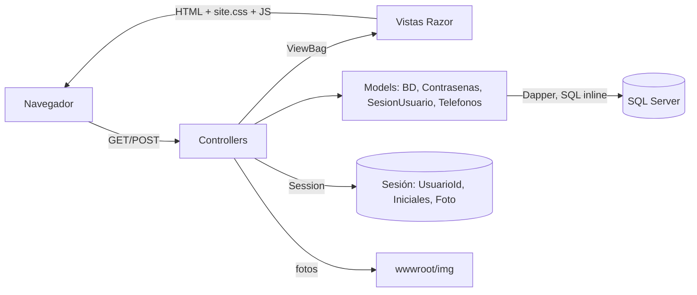

# Arquitectura

**Stack:** ASP.NET Core MVC (.NET 9, `net9.0`) · Razor (`.cshtml`) · Bootstrap 5 + Bootstrap Icons · JavaScript sin frameworks · Dapper 2.1.89 + Microsoft.Data.SqlClient 7.1.1 · SQL Server (base `Base_De_Datos_Swappit`). Ver [[Swappit.csproj]].

## Capas

- **Controllers** ([[AccountController]], [[ArticulosController]], [[PublicarController]], [[PerfilController]], [[ChatController]], [[HomeController]]): reciben el pedido, validan, llaman a [[BD]] y pasan los datos a la vista con `ViewBag` (ver [[Convenciones y decisiones]]).
- **[[BD]]** (`Models/BD.cs`): clase estática con todas las consultas. Cada método abre su propia `SqlConnection` y usa Dapper (`Query`, `QueryFirstOrDefault`, `Execute`). **El SQL está escrito dentro de C#**: no llama a ningún stored procedure (los SP de [[Script SQLSwappit.sql]] tienen el mismo nombre pero hoy no se usan, ver [[Pendientes y problemas]]).
- **Modelos** ([[Usuarios]], [[Articulos]], …): clases con las mismas columnas que las tablas, para que Dapper las llene.
- **ViewModels** ([[LoginViewModel]], [[RegistroViewModel]], [[EditarPerfilViewModel]], [[PublicarArticuloViewModel]]): reciben los formularios (POST) y tienen las validaciones con DataAnnotations. [[ArticuloCardViewModel]] y [[OpcionFiltroViewModel]] son resultados de consultas.
- **Vistas**: todas usan [[Vista _Layout]] (header, buscador, footer, JS comunes). Las cards de artículos son el partial [[Vista _CardObjeto]].
- **Frontend**: [[site.css]] (paleta oficial y componentes del UI Kit de Figma) y un JS por página.

## Sesión y autenticación
No se usa ASP.NET Identity ni cookies de autenticación: el login guarda `UsuarioId` en la **sesión** (`HttpContext.Session`, habilitada en [[Program.cs]]). Cada acción protegida pregunta `Session.GetInt32("UsuarioId")` y si es `null` redirige a `/Account` (login). [[SesionUsuario]] además guarda `Iniciales` y `Foto` para el avatar del header. Las contraseñas se guardan hasheadas con el `PasswordHasher` de ASP.NET ([[Contrasenas]]).

## Rutas
Ruta por defecto `{controller=Home}/{action=Index}/{id?}` ([[Program.cs]]). Las URLs principales:

| URL | Acción |
|---|---|
| `/` | [[HomeController]] Index |
| `/Articulos/Buscar?q=&categoria=&estado=` | [[ArticulosController]] Buscar |
| `/Articulos/Detalle/{id}` | [[ArticulosController]] Detalle |
| `/Publicar` | [[PublicarController]] Index (GET/POST) |
| `/Perfil`, `/Perfil/Publico/{id}`, `POST /Perfil/Editar` | [[PerfilController]] |
| `/Account` (login), `/Account/Registro`, `/Account/CambiarContrasena`, `/Account/Logout` | [[AccountController]] |
| `/Chat` | [[ChatController]] Index |
| `/Home/Privacy`, `/Home/Error` | [[HomeController]] |

## Archivos subidos
- Fotos de perfil: `wwwroot/img/perfiles/{idUsuario}_{ticks hexa}.ext` ([[PerfilController]]).
- Fotos de artículos: `wwwroot/img/articulos/{idUsuario}_{ticks}_{n}.ext` ([[PublicarController]]).
- Fotos de los artículos de prueba: `wwwroot/img/ArticulosPrueba/Fotos swappit objetos/*.jpg` (están en git, ver [[Script Datos.sql]]).
La ruta de cada foto se guarda en [[Tabla Imagenes]].
