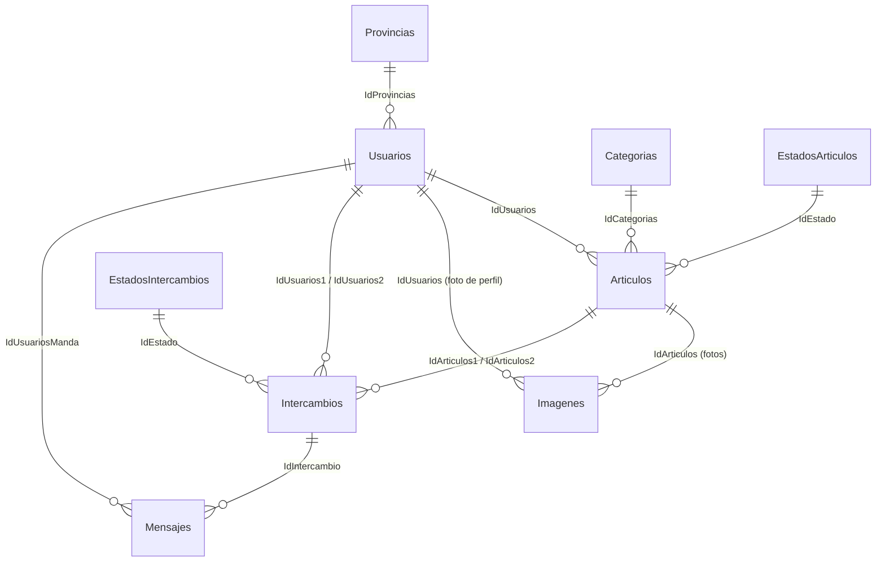

# Base de datos

SQL Server, base **`Base_De_Datos_Swappit`**. La app se conecta con la connection string fija de [[BD]] (`Server=localhost`, autenticación de Windows).

## Diagrama

## Tablas
[[Tabla Usuarios]] · [[Tabla Provincias]] · [[Tabla Articulos]] · [[Tabla Categorias]] · [[Tabla EstadosArticulos]] · [[Tabla Imagenes]] · [[Tabla Intercambios]] · [[Tabla EstadosIntercambios]] · [[Tabla Mensajes]]

## Stored procedures
- **Originales** (en todos los scripts): [[SP RegistrarUsuario]], [[SP RegistrarArticulo]], [[SP RegistrarIntercambio]], [[SP RegistrarMensaje]].
- **Nuevos del 28/10** (solo en [[Script SQLSwappit.sql]]), uno por método de [[BD]]: [[SP GetUsuarioByMail]], [[SP GetUsuarioById]], [[SP UsuarioExiste]], [[SP ActualizarContrasena]], [[SP UpdateUsuario]], [[SP GetFotoUsuario]], [[SP GuardarFotoUsuario]], [[SP BorrarFotoUsuario]], [[SP GetProvincias]], [[SP GetProvinciaById]], [[SP GetCategorias]], [[SP GetCategoriaById]], [[SP GetEstadosArticulos]], [[SP GetEstadoArticuloById]], [[SP GetArticuloById]], [[SP GetImagenesArticulo]], [[SP GetArticulosCatalogo]], [[SP GetFiltroCategorias]], [[SP GetFiltroEstados]], [[SP PublicarArticulo]].
- Ninguno se usa desde C# todavía (ver [[Pendientes y problemas]]).

## Scripts
| Script | Para qué |
|---|---|
| [[Script SQLSwappit.sql]] | Todo junto (base, tablas, datos, SP). UTF-16. Rutas de MSSQL14 fijas |
| [[Script SQLSwappit_CualquierCompu.sql]] | Igual pero sin rutas de archivos: sirve en cualquier compu |
| [[Script Estructura.sql]] | 1 de 3: base, usuario `alumno`, tablas y claves foráneas |
| [[Script Datos.sql]] | 2 de 3: datos de prueba |
| [[Script StoredProcedures.sql]] | 3 de 3: los 4 SP originales |
| [[Script Estados.sql]] | Migración para bases ya creadas: estados de texto → tablas con IdEstado |
| [[Script Provincias.sql]] | Inserta las 24 provincias (vuelve a insertarlas si ya están) |
