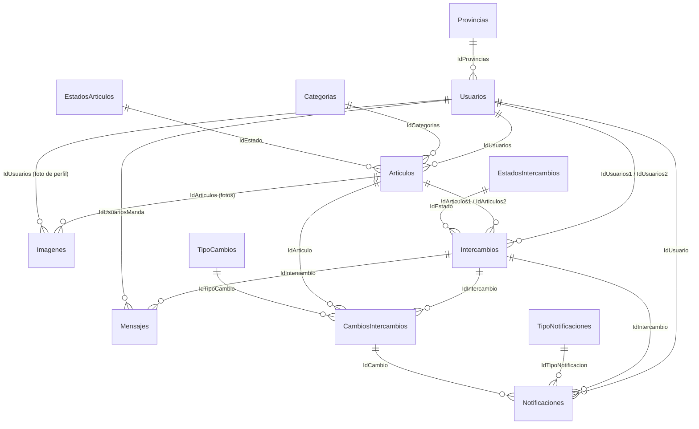

# Base de datos

SQL Server, base **`Base_De_Datos_Swappit`**. La app se conecta con la connection string fija de `ConexionBD.ConnectionString` ([[BD]]): `localhost`, autenticación de Windows (con SQL Express, `.\SQLEXPRESS`).

## Diagrama

## Tablas
[[Tabla Usuarios]] · [[Tabla Provincias]] · [[Tabla Articulos]] · [[Tabla Categorias]] · [[Tabla EstadosArticulos]] · [[Tabla Imagenes]] · [[Tabla Intercambios]] · [[Tabla EstadosIntercambios]] · [[Tabla Mensajes]] · [[Tabla Notificaciones]] · [[Tabla TipoNotificaciones]] · [[Tabla ArticulosIntercambios]] · [[Tabla CambiosIntercambios]] · [[Tabla TipoCambios]]

## Stored procedures
Desde el 17/11 la app usa **solo** stored procedures: cada método de [[BD]] llama a uno. Son 72, iguales en los tres scripts:
- **Originales**: [[SP RegistrarUsuario]] (desde el 17/11 lo usa el registro), [[SP RegistrarArticulo]], [[SP RegistrarIntercambio]] y [[SP RegistrarMensaje]] (estos tres sin uso).
- **Del 28/10**, usuarios, artículos y filtros: [[SP GetUsuarioByMail]], [[SP GetUsuarioById]], [[SP UsuarioExiste]], [[SP ActualizarContrasena]], [[SP UpdateUsuario]], [[SP GetFotoUsuario]], [[SP GuardarFotoUsuario]], [[SP BorrarFotoUsuario]], [[SP GetProvincias]], [[SP GetProvinciaById]], [[SP GetCategorias]], [[SP GetCategoriaById]], [[SP GetEstadosArticulos]], [[SP GetEstadoArticuloById]], [[SP GetArticuloById]], [[SP GetImagenesArticulo]], [[SP GetArticulosCatalogo]], [[SP GetFiltroCategorias]], [[SP GetFiltroEstados]], [[SP PublicarArticulo]]. Después se sumaron [[SP GetEstadosIntercambios]], [[SP GetCantidadNotificacionesNoLeidas]] y [[SP MarcarNotificacionesLeidas]].
- **Del 17/11** (devolución docente), intercambios, cambios, chat, favoritos, notificaciones y recomendaciones: [[SP CrearNotificacion]], [[SP RechazarPendientesDeArticulos]], [[SP AgregarArticulos]], [[SP AlternarFavorito]], [[SP ArticuloComprometido]], [[SP CambiarEstadoIntercambio]], [[SP CancelarCambio]], [[SP CancelarIntercambio]], [[SP ContarArticulosActivos]], [[SP ContarCambiosPendientes]], [[SP ContarIntercambiosActivos]], [[SP ContarIntercambiosPorEstado]], [[SP ContarMensajesNoLeidos]], [[SP ContarPendientesDeArticulos]], [[SP CrearPedido]], [[SP EnviarMensaje]], [[SP GetArticulosDeIntercambio]], [[SP GetCambiosIntercambio]], [[SP GetCategoriasDeUsuario]], [[SP GetDatosMailNotificacion]], [[SP GetFavoritos]], [[SP GetIdPropuestaEnCurso]], [[SP GetIdsFavoritos]], [[SP GetIntercambios]], [[SP GetMensajes]], [[SP GetNotificaciones]], [[SP GetPopularidad]], [[SP GetResumenesChat]], [[SP GetSenalesGustos]], [[SP GetUltimoCambio]], [[SP GuardarSegundosVista]], [[SP ImportarFavoritos]], [[SP IntercambioConArticuloComprometido]], [[SP MarcarMensajesVistos]], [[SP MarcarNotificacionLeida]], [[SP ProponerIntercambio]], [[SP RegistrarBusqueda]], [[SP RegistrarVista]], [[SP ResponderCambio]]. [[SP CrearNotificacion]] y [[SP RechazarPendientesDeArticulos]] solo los llaman otros SP.
- **Consultas complejas** de la materia (06/11), sin uso desde la app: [[SP Complejos_Ejecucion]], [[SP Complejos_EstadisticasUsuario]], [[SP Complejos_Personalizado_GestionarPropuestaYNotificacion]], [[SP Complejos_RecomendarUsuariosIntercambio]], [[SP Complejos_RendimientoPlataformaPorPeriodo]], [[SP Complejos_SeguimientoIntercambiosPendientes]].
- Cómo se les pasan las listas, las transacciones y las notificaciones: ver [[BD]].

## Scripts
| Script | Para qué |
|---|---|
| [[Script SQLSwappit.sql]] | Todo junto (base, tablas, datos, SP). UTF-16. Rutas de MSSQL14 fijas |
| [[Script SQLSwappit_CualquierCompu.sql]] | Igual pero sin rutas de archivos: sirve en cualquier compu |
| [[Script Estructura.sql]] | 1 de 3: base, usuario `alumno`, tablas y claves foráneas |
| [[Script Datos.sql]] | 2 de 3: datos de prueba |
| [[Script StoredProcedures.sql]] | 3 de 3: los 72 SP |

Desde el 14/11 no hay scripts de migración ([[Reglas de trabajo]]): cada cambio va en los dos scripts principales y en los tres de `BaseDatos/`, y Rafael actualiza su base por su cuenta. Los scripts sueltos de antes ya no están en el repo: [[Script Estados.sql]], [[Script Notificaciones.sql]], [[Script Chat.sql]], [[Script Cancelado.sql]], [[Script Provincias.sql]], [[Script ProvinciasDuplicadas.sql]], [[Script TelefonoTexto.sql]] y [[Script ArticulosIntercambios.sql]].
